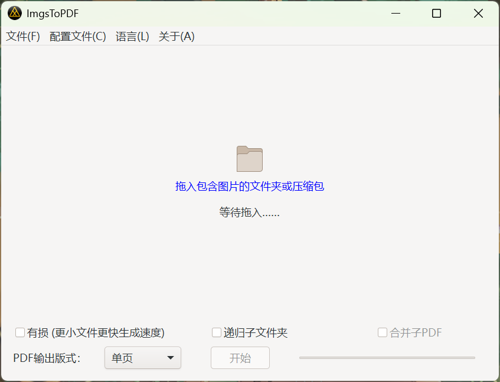
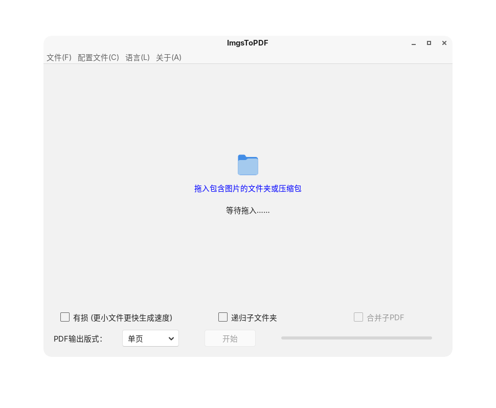

# GTK_ImgsToPDF

## 功能

- 将文件夹内的图片批量合并为 PDF，过程中不修改图片尺寸。
- **多图合并**：菜单「选择图片组」或直接拖入一组图片，按文件名中的数字顺序合并为一个 PDF。
- **多 PDF 合并**：菜单「选择PDF」或直接拖入一组 PDF，合并为 `<目录名>_Merged.pdf`。
- **小说模式**：双页左至右 / 右至左排版，自动双页拼接并让横向长图单独成页。
- **递归子目录**：对选中目录及其所有子目录各生成一份 PDF，可选再合并为一份带多级书签的总册。
- 支持 JPEG / PNG / APNG / GIF / BMP / TIFF / WebP；非快速模式下原始字节直通，**不做重编码**。
- EXIF 方向（1~8 全部）由排版期仿射矩阵应用，不因旋转而重新压缩图像。
- 支持 zip / rar / 7z：整包解压后按子目录结构输出；加密包（含 RAR/7z 头部加密）会弹出密码框。
- 页尺寸可在 `Core/config.lua` 中配置（A0-A10、B0-B10 等），或留空以跟随图片尺寸。
- 排序规则同样在 `config.lua` 中定义，默认按文件名中的数字段自然排序。
- 中英文界面切换。

## 软件界面

### Windows


### Linux


## 构建与发布

需要 .NET 10 SDK（Linux 上另需 GTK3 运行时，如 `libgtk-3-dev`）。

```bash
# Windows 发布（GUI 单文件 + Core/ 子进程目录）
dotnet publish GTK_ImgsToPDF/GTK_ImgsToPDF.csproj -c Release -r win-x64

# Linux 发布
dotnet publish GTK_ImgsToPDF/GTK_ImgsToPDF.csproj -c Release -r linux-x64
```

发布目录包含 GUI 主程序和 `Core/`（`ImgsToPDFCore` 子进程及其 `config.lua`、`Modules/`）。
Core 由管线自动以自包含单文件方式发布并镜像进来，无需手动复制。

日常调试直接在 IDE 里运行或 `dotnet build`：构建会把 Core 的开发版（框架依赖、仅当前平台）
镜像到输出目录的 `Core\`，开发机装有 .NET 运行时即可运行。

